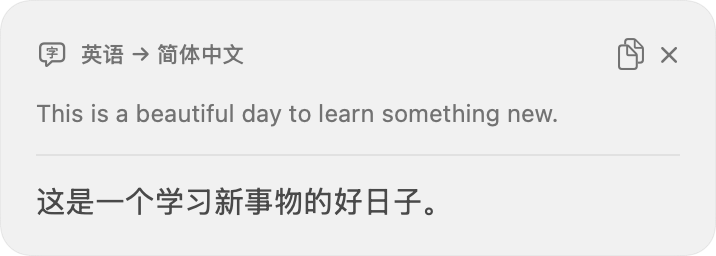
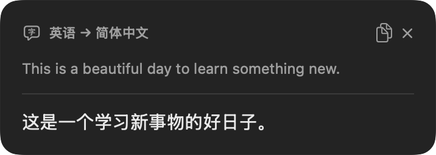
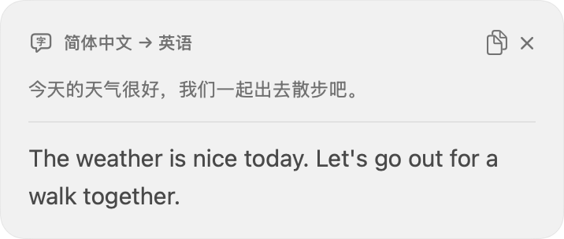

# HoldTranslate

轻量 macOS 菜单栏划词翻译工具。按住修饰键划选文字，松开鼠标，在原位置附近阅读译文。

使用 SwiftUI、AppKit、Accessibility、NaturalLanguage 和 Apple Translation。无第三方依赖，无账号或 API Key，无翻译历史。

## 系统要求

- macOS 15 或更新版本；优先 Apple Silicon。
- 构建需要 Xcode 26.4 或更新版本的 SDK（本项目实际使用 Xcode 27.1 编译）；应用运行最低为 macOS 15。
- 需要辅助功能权限，且源应用必须通过 Accessibility 提供选中文字。
- 首次使用需要联网下载系统翻译语言包。

## 构建与运行

```sh
./scripts/build.sh
open build/Distribution/HoldTranslate.app
```

也可以打开 `HoldTranslate.xcodeproj`，选择 HoldTranslate scheme 后运行。`Package.swift` 用于核心逻辑、请求生命周期和窗口行为单元测试：

```sh
swift test
```

提交的 Xcode 工程无需第三方生成器。添加 Swift 文件后可运行 `python3 scripts/generate-project.py` 重新生成工程。

发布构建位于 `build/Distribution/HoldTranslate.app`，不提交构建缓存。建议复制到固定位置（例如 `~/Applications`）再授权和启用登录启动。移动或重新签名后，系统可能要求重新授权。若开关已开启但应用仍提示未授权，请在辅助功能列表移除旧 HoldTranslate，再通过加号添加当前路径的应用；单纯关闭后再开启可能无法刷新旧 ad-hoc 签名记录。

本地构建使用 ad-hoc 签名；**没有 Developer ID 签名或公证**，不能宣称通过 Gatekeeper 分发验证。若自行分发，请使用自己的开发者证书签名并公证。不要关闭系统安全保护。

## 使用

1. 启动后在设置中阅读权限说明，点击「前往授权」。在系统设置 → 隐私与安全性 → 辅助功能中开启 HoldTranslate。
2. 回到设置，点击「准备语言包」，完成系统下载确认。
3. 在其他应用按住 **⌥ Option**，拖动选中文字，然后松开鼠标。
4. 也可以先选中文字，再按 **⌥D**（Option + D）。在菜单栏 → 设置 →「选中后翻译」点击快捷键按钮，直接按下新组合即可保存；Esc 取消，「恢复默认」改回 ⌥D。设置会在重启后保留，已占用的组合会提示冲突。
5. 气泡不会激活应用。点击小复制按钮才会主动将译文写入剪贴板。

Option 会影响某些应用的选区行为（例如矩形选择）。可切换到 Control 或 Option + Command；Control 也可能触发原应用上下文菜单。划选事件只读监听。「选中后翻译」使用系统全局快捷键注册，按下组合时由 HoldTranslate 处理，避免 Option+D 在编辑器中输入特殊字符。选择组合时请避开自己常用的编辑命令。

默认中文翻译为英文，其他可识别语言翻译为简体中文；可手动指定目标语言。长选区（超过 5,000 字）、空白、数字、明显 URL/代码和无法可靠识别的内容会得到简洁提示。

默认气泡提供至少约 12 秒阅读时间，长译文更久；鼠标悬停时不会自动关闭。可以改成松键后收起或手动收起。点击外部、继续输入、滚动、切换应用/Space 均收起。菜单栏支持暂停、设置和退出。默认不显示 Dock 图标。

## 权限与隐私

- 辅助功能权限用于监听触发动作和读取用户明确选择的文字。
- 不申请屏幕录制；不主动申请输入监控；不安装事件拦截 tap。
- 不记录按键内容，不读取完整文档。默认不读取剪贴板或模拟 Command-C；只有点击「复制选区并翻译」或明确启用复制兼容模式时才临时读取、复制并尝试恢复剪贴板。
- 安全输入控件跳过。AX 操作在后台执行且有超时与候选数量上限。
- 原文和译文只在当前请求/气泡期间存在内存中；不写入历史或日志。
- 点击气泡中的小复制按钮会将译文写入剪贴板。复制兼容模式也会临时改变剪贴板，并备份原有的多个项目和格式；检测到并发所有权变化时保留新内容。延迟生成/过大/无法完整备份的数据会拒绝兼容操作。
- 翻译使用 Apple 系统框架在设备端处理；语言资源下载由系统管理。Apple 可能收集框架使用与性能指标，但不含原文/译文，详见[官方说明](https://developer.apple.com/documentation/Translation/TranslationSession)。应用本身没有遥测。

## 工程设计

- `Core`：可测试的手势状态机、文本/语言策略、多屏位置计算。
- `SelectionReader`：actor 隔离的有界 AX 查询；读取 focused / hit-test 元素及有限父节点的选区。
- `InputMonitor`：NSEvent 只读全局监听；浮窗不可见时不监听 mouseMoved，无周期性轮询。
- `TranslationModel`：检查语言包、请求代次、过期响应隔离和超时。
- `TranslationWorker`：每个请求一个 SwiftUI `.translationTask`；视图销毁即取消任务。
- `BubbleController`：不激活 NSPanel、屏幕边缘定位、悬停保护和一次性关闭定时器。
- `SettingsView`：权限状态、系统登录项、主动语言资源准备。

## 兼容性与测试

详见 [测试记录与手工步骤](docs/TESTING.md) 和 [开发进度](PROGRESS.md)。Safari、Chrome、Notes、Pages、Finder、PDF 是否可读取取决于它们实际暴露的 AX 选区；不支持的界面会提供明确的复制兼容入口；只有实际复制到新的文字后才提交翻译，不把原剪贴板当作选区。

最低目标是 macOS 15，但本机只能实际运行 macOS 26.6.2；旧系统和物理多显示器验证仍需要对应设备。不同系统版本和语言包状态可能影响速度、语言支持和离线可用性。


## 已验证的界面

以下图片由生产气泡视图和真实 Apple Translation 响应生成，使用固定合成测试文本，不含用户文档。它们是应用视图渲染截图，不是全屏截图。





设备端视觉集成测试（先安装英语与简体中文语言资源）：

```sh
./scripts/visual-test.sh
```

覆盖英译中、深色外观、中译英、单词和长文本；短译文过高或长文无界增长会令测试失败。`--traditional` 额外测试繁体中文，需要对应系统语言资源。


## 1.0.1 兼容性修复

- 全局拖动使用鼠标事件自身的历史坐标，避免异步回调中当前鼠标位置导致距离被误判为零；中间拖动回调缺失时仍可由按下/松开位置的明显位移确认拖动。
- 不同安装路径只能运行一个实例，避免构建目录与正式安装版本同时监听。
- 对支持 AX text marker 的网页引擎尝试读取标记选区。
- 微信朋友圈等界面可能不公开 AX 选中文字。此时点击气泡的「复制选区并翻译」，或在设置 → 权限与隐私中明确启用「选区不可访问时使用复制兼容模式」。
- 复制兼容模式默认关闭，复制只发给当前源应用。安全输入区域不执行；取消翻译仍会等待短暂的剪贴板恢复事务完成。它并非所有应用的通用保证：第三方应用迟到或异常的复制、并发剪贴板修改、macOS 剪贴板服务错误可能影响恢复，应以提示及实际剪贴板内容为准。

## 1.0.2 三指拖移

按住 Option 使用系统三指拖移选词时，抬起手指后可以自然松开 Option。应用会为已经发生的真实拖动保留短暂的结束宽限期，等待系统的延迟鼠标松开事件；也允许从真实拖动事件开始识别。不改变系统触控板设置，不读取原始多点触控数据，也不新增权限。

用户已实测确认三指拖移可以弹出翻译。微信朋友圈仍存在 AX 选区不公开、兼容复制被安全检查拒绝的问题，尚未解决；按用户要求暂停该场景排查。

系统拖移结束可能稍有延迟；目前代码及事件序列回归已通过，具体硬件行为仍以实机验证记录为准。
